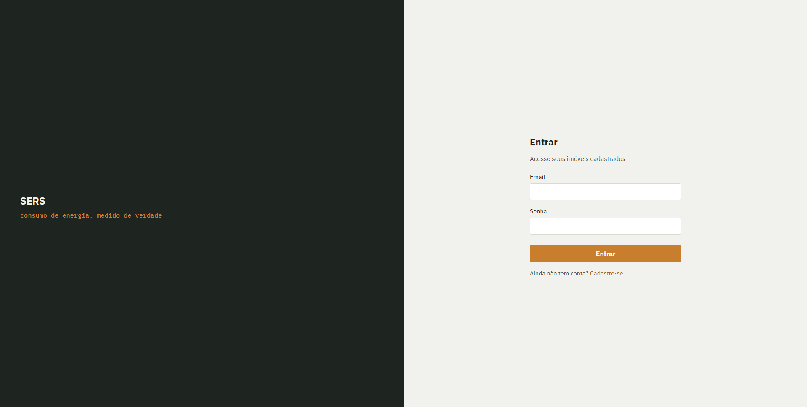
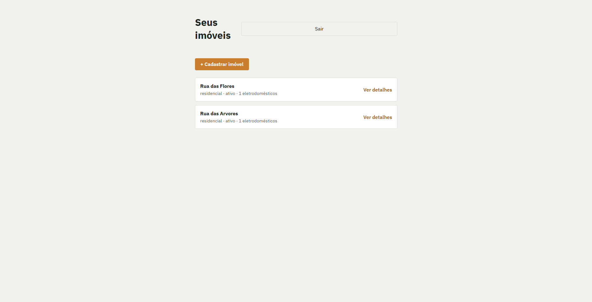
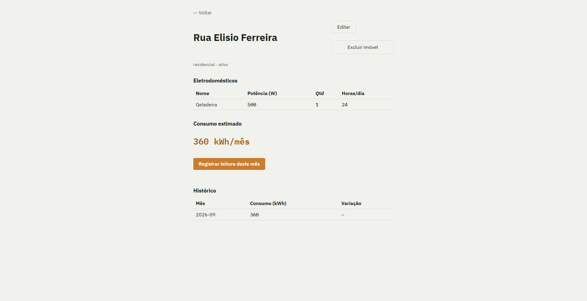

# Cadastro de Energia — SERS

Sistema para cadastro de imóveis e eletrodomésticos, com cálculo e histórico de consumo de energia (kWh). Desenvolvido como projeto acadêmico.

## Equipe

| Nome | Matrícula |
|------|-----------|
| Davi Ramos Silva | 571744 |
| Lucas Galle Melchior | 574027 |
| Gustavo Bonamico Piccoli | 569984 |
| Victor Hugo Ferreira Freire | 571099 |
| Julian Moncoski| 572603 |

📄 [Ver documentação de arquitetura](./ARQUITETURA.md)

## Sobre o projeto

O sistema permite que um usuário se cadastre, registre seus imóveis com os eletrodomésticos de cada um, e acompanhe o consumo estimado de energia (kWh/mês) por eletrodoméstico e por imóvel, além de manter um histórico mensal com comparativos.

## Capturas de tela

| Login | Lista de imóveis | Detalhe do imóvel |
|---|---|---|
|  |  |  |

## Stack tecnológica

- **Backend**: Node.js + Express
- **ORM**: Prisma
- **Banco de dados**: Supabase (PostgreSQL)
- **Frontend**: React (Vite)
- **Autenticação**: JWT + bcrypt

## Estrutura do repositório

```
cadastro-energia-casa/
├── backend/     # API REST (Express + Prisma)
├── frontend/    # Interface (React + Vite)
├── docs/        # Capturas de tela
├── Backlog Projeto SERS.docx
├── ARQUITETURA.md
└── README.md
```

## Como rodar

### Backend

```bash
cd backend
npm install
npx prisma migrate dev --name init
node app.js
```

Preencha o `.env` com `DATABASE_URL` (conexão direta do Supabase, porta 5432) e `JWT_SECRET` antes de rodar.

### Frontend

```bash
cd frontend
npm install
npm run dev
```

## Backlog → Implementação

Mapeamento de cada item do Product Backlog (ver `Backlog Projeto SERS.docx` e `ARQUITETURA.md`) para onde foi implementado no código.

| PB | Solicitado | Onde foi atingido |
|---|---|---|
| **PB01** | Interface de Cadastro (nome, email, senha) | Backend: `authController.js` (`register`), rota `POST /auth/register`. Frontend: `pages/Register.jsx` |
| **PB02** | LogIn com validação dos dados | Backend: `authController.js` (`login`), rota `POST /auth/login`. Frontend: `pages/Login.jsx` |
| **PB03** | Cadastro de Imóveis (infos do imóvel) | Backend: `imovelController.js` (`criar`), rota `POST /imoveis` (cria imóvel + eletrodomésticos juntos). Frontend: `pages/ImovelForm.jsx` |
| **PB04** | Visualização de Imóveis cadastrados (estar logado) | Backend: `imovelController.js` (`listar`), rota `GET /imoveis`, protegida por `middlewares/auth.js`. Frontend: `pages/Dashboard.jsx` |
| **PB05** | Editar/Excluir Imóveis (alterar status) | Backend: `imovelController.js` (`atualizar`, `excluir`), rotas `PUT` e `DELETE /imoveis/:id`. Frontend: `pages/ImovelDetail.jsx` (edição inline e exclusão) |
| **PB06** | Visualização de Consumo (kWh) | Backend: `consumoController.js` (`calcular`), rota `GET /imoveis/:id/consumo`. Frontend: seção "Consumo estimado" em `pages/ImovelDetail.jsx` |
| **PB07** | Análise e armazenamento de dados antigos (comparativos) | Backend: `consumoController.js` (`registrar`, `historico`), rotas `POST`/`GET /imoveis/:id/historico` (com cálculo de variação mês a mês). Frontend: tabela de histórico em `pages/ImovelDetail.jsx` |
| **PB08** | Alerta e Validação de Inconsistências (dados negativos/inválidos/vazios) | Backend: validação de email e senha mínima em `authController.js`; validação de potência/quantidade/horas em `imovelController.js` (`validarEletrodomesticos`). Frontend: limites `min`/`max` nos campos de `pages/ImovelForm.jsx` |
| **PB09** | Proteção dos Dados (privacidade de acesso) | Backend: hash de senha com `bcrypt`, autenticação via JWT em `middlewares/auth.js`, verificação de propriedade do recurso (`usuarioId`) em todas as rotas de imóvel/consumo |

## Evolução Fotovoltaica → Implementação

Segunda fase do backlog (`PBs_Sistema_Fotovoltaico_Tasks.pdf`, PB01–PB20). Os códigos abaixo são os do **novo** backlog fotovoltaico, não os PB01–PB09 da tabela anterior.

| PB | Task | Onde foi atingido |
|---|---|---|
| **PB01** | 1. Reaproveitar consumo cadastrado | `services/dimensionamento.js` (`calcularSugestaoReferencia`: média do histórico → fallback estimativa dos eletrodomésticos); `GET /imoveis/:id/dimensionamento/referencia` |
| | 2. Seleção do imóvel de referência | `frontend/src/pages/Dimensionamento.jsx` (select de imóveis, rota `/dimensionamento/novo/:imovelId?`) |
| | 3. Exibir/ajustar localidade | Campos `cidade`/`uf` em `Imovel` (schema + migration); `ImovelForm.jsx`, `ImovelDetail.jsx` e `Dimensionamento.jsx` |
| | 4. Ajuste manual do consumo (kWh/mês) | `validarConsumoManual` + campo "Ajustar consumo de referência" |
| | 5. Histórico mínimo | `HISTORICO_MINIMO_MESES` (1) em `services/dimensionamento.js` |
| | 6. Bloquear sem referência | `resolverConsumoReferencia` → `400 SEM_CONSUMO_REFERENCIA`; botão desabilitado no frontend |
| **PB02** | 1–2. Campo de percentual, padrão 100% | `Dimensionamento.jsx`; `PERCENTUAL_PADRAO` |
| | 3–4. Validar 1–100%, rejeitar negativos/não numéricos | `validarPercentual` (backend) + validação espelhada no frontend |
| | 5. Persistir com o cenário | Model `CenarioDimensionamento`; `POST/GET/PUT /imoveis/:id/cenarios` |

Testes unitários das regras: `cd backend && npm test`. Após puxar estas mudanças, rode `npx prisma migrate dev` para aplicar a migration `dimensionamento_cenario`.
| **PB03** (fotovoltaico) | 1. Dataset de HSP | `backend/data/hsp_por_uf.csv` (27 UFs, com região e fonte), carregado e validado por `services/hsp.js` (`carregarTabelaHsp`) |
| | 2. Associar HSP à localidade | `obterHspPorUf` / `resolverHsp`; `GET /dimensionamento/hsp?uf=`; HSP gravado no cenário (`hspKwhM2Dia`) |
| | 3. Sobrescrita manual | Campo "Sobrescrever HSP" em `Dimensionamento.jsx`; `PUT` aceita `hspKwhM2Dia` e `usarHspTabela` |
| | 4. Registrar e exibir fonte | Campos `hspOrigem` e `hspFonte` no cenário, exibidos na tela |
| | 5. Faixa plausível | `HSP_MIN = 3` e `HSP_MAX = 6.5` em `services/hsp.js` (backend e frontend) |
| **PB04** (fotovoltaico) | 1. Fórmula E_FV = C_m × f | `calcularEnergiaFv` em `services/dimensionamento.js` |
| | 2. Validar C_m e f | Mesma função (C_m > 0; f entre 1% e 100%) |
| | 3. Exibir em kWh/mês | Seção "Energia mensal a gerar" em `Dimensionamento.jsx` |
| | 4. Recalcular ao alterar parâmetro | Ao vivo no frontend; `PUT /imoveis/:id/cenarios/:cenarioId` recalcula e persiste |
| | 5. Log/evidência | Model `CenarioCalculoLog`; `GET /imoveis/:id/cenarios/:cenarioId/logs`; botão "Ver memória de cálculo" |

Atenção: os valores de `hsp_por_uf.csv` são médias anuais aproximadas por UF e devem ser conferidos no CRESESB SunData antes de entrega formal.


## Sprint 3 — Dimensionamento completo → Implementação

Backlog: `Sprint_3_Product_Backlog_Final.pdf` (PB01–PB21). Os códigos abaixo são os do backlog da Sprint 3.

| PB | Task | Onde foi atingido |
|---|---|---|
| **PB14** | Comparar potência FV, módulos, inversor, geração, atendimento, armazenamento, autonomia e investimento | `backend/services/comparacao.js` (`compararCenarios`, `CRITERIOS`): tabela com valor sem baterias, com baterias, diferença absoluta e percentual |
| | Apresentar os dois cenários de forma comparável | `POST /dimensionamento/comparacao` (`controllers/comparacaoController.js`) recebe `{ semBaterias, comBaterias }` e devolve `criterios`, `resumo` (investimento adicional, ganho de atendimento, custo por ponto percentual) e `avisos` |
| | Validação (PB18) | `validarCenario`: campos ausentes, negativos, não numéricos, baterias no cenário sem baterias, divisão por zero tratada (`null`) |
| **PB15** | Identificar a tarifa utilizada | `backend/services/economia.js` (`calcularEconomia`): a tarifa (R$/kWh) e a **fonte** são obrigatórias e devolvidas no resultado; nenhum valor fixo no código |
| | Identificar a energia compensada | `energiaCompensadaKwhMes` = menor valor entre geração e consumo (ou valor informado); o excedente é mostrado à parte |
| | Economia mensal e anual | `economiaMensal = E_compensada × tarifa`; `economiaAnual = mensal × 12`; `memoriaCalculo` com fórmula e entradas |
| | Exibir as premissas | lista `premissas` (tarifa constante, sem crédito de excedente, sem degradação, estimativa e não previsão exata) |
| | Rota | `POST /dimensionamento/economia` (`controllers/economiaController.js`); validação de tarifa, fonte, consumo, geração e compensada |
| **PB16** | Apresentar como payback simples | `backend/services/payback.js` (`calcularPayback`): `tipo: "payback simples"` e descrição iniciada por "Payback simples" |
| | Fórmula | `Payback = Investimento / Economia_anual`, em anos e meses (arredondados para cima), com `memoriaCalculo`; economia anual zero devolve `null` com explicação, sem divisão por zero |
| | Não apresentar como previsão exata | lista `premissas` (sem juros, inflação, reajuste, degradação ou manutenção; "não é previsão financeira exata") e `avisos` para prazos acima de 25 anos |
| | Rota | `POST /dimensionamento/payback` (`controllers/paybackController.js`); recebe `investimentoTotal` (PB13) e `economiaAnual` (PB15) |
| **PB17** | Apresentar residência, consumo, HSP, potência necessária e instalada, módulos, inversor, geração, atendimento, baterias/autonomia, orçamento, economia e payback | `backend/services/proposta.js` (`montarProposta`): consolida tudo em um objeto; o orçamento é calculado (`Custo_item = quantidade × preço`, `Custo_total = Σ`) e a economia e o payback reaproveitam `economia.js` e `payback.js` |
| | Relatório | `renderizarHtml`: página HTML com todas as seções, premissas e avisos (texto do usuário escapado); baterias/autonomia só aparecem quando há baterias |
| | Rota | `POST /dimensionamento/proposta` (JSON) e `?formato=html` (relatório) em `controllers/propostaController.js`; valida HSP, PR (0 a 1, com justificativa), fonte da HSP, consumo e itens do orçamento |

Testes: `cd backend && npm test` (`tests/comparacao.test.js`, `tests/economia.test.js`, `tests/payback.test.js`, `tests/proposta.test.js`).

**Dependência:** a PB14 compara resultados calculados pelas PB04–PB13 (potência FV, módulos, inversor, geração, atendimento, baterias, orçamento). Esses cálculos ainda não existem no código; a rota de comparação recebe os dois resultados prontos e não fixa nenhum equipamento ou preço.
